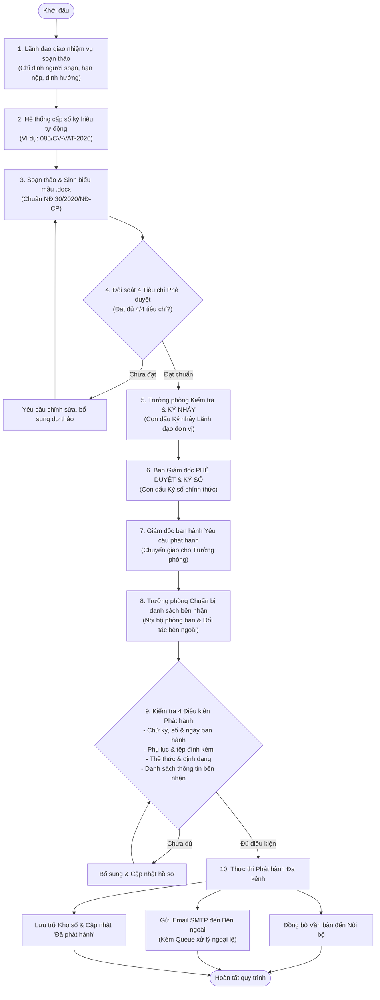
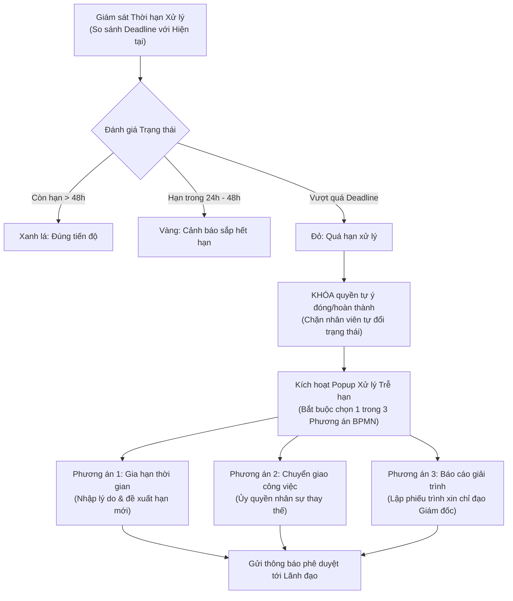
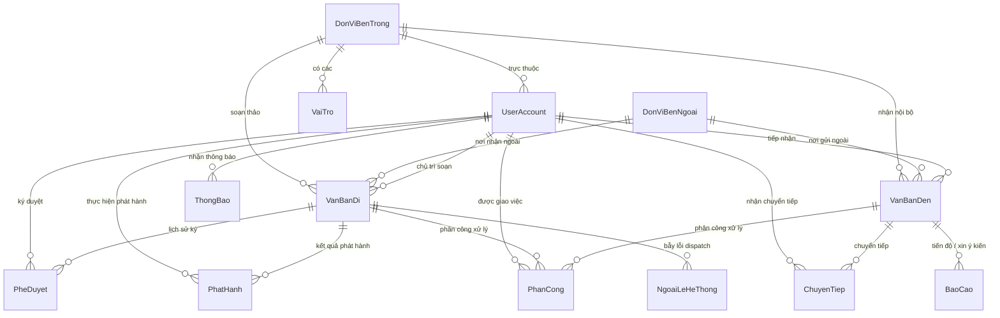

<div align="center">

# 🏛️ HỆ THỐNG QUẢN LÝ VĂN BẢN & ĐIỀU HÀNH CÔNG VIỆC
### VIETASIA TRAVEL — DOCUMENT MANAGEMENT SYSTEM (QLVB)

[](https://www.python.org/)
[](https://www.djangoproject.com/)
[](https://supabase.com/)
[](https://ai.google.dev/)
[](https://www.omg.org/spec/BPMN/2.0/)
[](https://vanban.chinhphu.vn/)

*Hệ thống chuyển đổi số toàn diện trong quản lý văn bản đi, văn bản đến, kiểm duyệt 2 cấp ký số, giám sát tiến độ SLA theo chuẩn BPMN 2.0, tự động trích xuất thông tin bằng Trí tuệ Nhân tạo (AI OCR) và hàng đợi phát hành ngoại lệ bền bỉ.*

---

</div>

## 📑 MỤC LỤC
1. [Giới thiệu Tổng quan](#-1-giới-thiệu-tổng-quan)
2. [Điểm sáng Công nghệ & Kiến trúc](#-2-điểm-sáng-công-nghệ--kiến-trúc)
3. [Quy trình Nghiệp vụ Chuẩn hóa BPMN 2.0](#-3-quy-trình-nghiệp-vụ-chuẩn-hóa-bpmn-20)
   - [3.1. Quy trình Quản lý Văn bản Đi (2 cấp phê duyệt & Phát hành)](#31-quy-trình-quản-lý-văn-bản-đi)
   - [3.2. Quy trình Quản lý Văn bản Đến & Trợ lý AI OCR](#32-quy-trình-quản-lý-văn-bản-đến--trợ-lý-ai-ocr)
   - [3.3. Trung tâm Xử lý Văn bản Tập trung (Unified Processing Hub)](#33-trung-tâm-xử-lý-văn-bản-tập-trung)
   - [3.4. Quản lý Tiến độ & Xử lý Trễ hạn SLA (3 Phương án BPMN)](#34-quản-lý-tiến-độ--xử-lý-trễ-hạn-sla)
4. [Hệ thống Ngoại lệ & Hàng đợi Thử lại (Exception & Retry Queue)](#-4-hệ-thống-ngoại-lệ--hàng-đợi-thử-lại)
5. [Kiểm soát Phân quyền (RBAC) & Tách bạch Quản trị viên](#-5-kiểm-soát-phân-quyền-rbac--tách-bạch-quản-trị-viên)
6. [Cấu trúc Cơ sở Dữ liệu (Database Architecture)](#-6-cấu-trúc-cơ-sở-dữ-liệu-database-architecture)
7. [Danh bạ Phòng ban & Tài khoản Vận hành Thực tế](#-7-danh-bạ-phòng-ban--tài-khoản-vận-hành-thực-tế)
8. [Hướng dẫn Cài đặt & Triển khai](#-8-hướng-dẫn-cài-đặt--triển-khai)
9. [Cấu hình Biến môi trường (.env)](#-9-cấu-hình-biến-môi-trường-env)
10. [Bộ Kiểm thử Tự động (Automated Verification Suites)](#-10-bộ-kiểm-thử-tự-động)

---

## 🌟 1. GIỚI THIỆU TỔNG QUAN

**Vietasia Travel QLVB** là giải pháp phần mềm quản lý điều hành văn bản điện tử chuyên nghiệp, phục vụ nhu cầu luân chuyển hồ sơ, phê duyệt tờ trình, công văn, quyết định và phân công xử lý công việc cho doanh nghiệp du lịch lữ hành.

Hệ thống được thiết kế tuân thủ nghiêm ngặt:
- **Nghị định số 30/2020/NĐ-CP** của Chính phủ về công tác văn thư (thể thức văn bản, đánh số ký hiệu tự động, quy cách ban hành).
- **Mô hình BPMN 2.0 (Business Process Model and Notation)** chuẩn hóa 100% các luồng: Phân công soạn thảo -> Thẩm định 4 tiêu chí -> Phê duyệt 2 cấp (Ký nháy & Ký số chính thức) -> Thẩm định phát hành 4 điều kiện -> Phát hành đa kênh nội bộ & email bên ngoài.
- **Tự động hóa thông minh (Document AI)**: Nhận dạng ký tự quang học (OCR) từ scan PDF/ảnh, tự động phân loại lĩnh vực và tóm tắt thông minh.

---

## 🛠️ 2. ĐIỂM SÁNG CÔNG NGHỆ & KIẾN TRÚC

| Thành phần | Công nghệ / Thư viện | Vai trò chức năng |
|---|---|---|
| **Core Backend** | Python 3.11+, Django 5.2.12 | Khung ứng dụng MVC/MVT hiệu năng cao, định tuyến và xử lý nghiệp vụ bảo mật |
| **Database** | PostgreSQL on Supabase Cloud | Cơ sở dữ liệu quan hệ mạnh mẽ, kết nối qua Transaction Pooler port 6543 |
| **Document Engine** | `python-docx`, `pypdf`, `Pillow` | Tự động sinh văn bản mẫu Word (.docx), phân tách và kết xuất tệp đính kèm |
| **Computer Vision** | `OpenCV (cv2)` | Tiền xử lý hình ảnh, cân bằng sáng, khử nhiễu tài liệu scan phục vụ OCR |
| **AI Multi-Provider** | Google Gemini API, Groq Cloud (Llama 3.3 70B) | Cơ chế Waterfall đa tầng: Trích xuất OCR văn bản đến, gợi ý phân công lãnh đạo và tóm tắt thông minh |
| **Digital Signature** | HTML5 Canvas API | Trực quan hóa con dấu ký nháy của Trưởng phòng và chữ ký số chính thức của Ban Giám đốc |
| **Smart Form UI** | Modern CSS3, Choices.js, Feather Icons | Giao diện công sở thân thiện, tìm kiếm chọn lọc người xử lý thông minh |
| **Mail & Resilience** | Django SMTP, Centralized Error Queue | Gửi thông báo phát hành văn bản, mã OTP xác thực mật khẩu, lưu vết ngoại lệ và cơ chế thử lại tự động |

---

## 🔄 3. QUY TRÌNH NGHIỆP VỤ CHUẨN HÓA BPMN 2.0

### 3.1. Quy trình Quản lý Văn bản Đi

Hệ thống thực hiện quy trình khép kín từ khi giao việc soạn thảo tới khi văn bản được phát hành chính thức đến các bên nhận:



#### Chi tiết các bước thực hiện:
1. **Phân công soạn thảo**: Trưởng phòng hoặc Ban Giám đốc chỉ định người chắp bút, ấn định thời hạn nộp dự thảo và định hướng nội dung yêu cầu.
2. **Cấp số ký hiệu tự động**: Hệ thống tự động tính toán số thứ tự tăng dần theo năm và mã định danh nghiệp vụ: `[Số]/[Loại VB]-[Mã đơn vị]-[Năm]` (Ví dụ: `085/CV-VAT-2026`).
3. **Sinh biểu mẫu tự động**: Tạo tệp Word `.docx` tích hợp quốc hiệu, tiêu ngữ, thông tin đơn vị gửi, trích yếu và nơi nhận đúng chuẩn hành chính.
4. **Bộ 4 Tiêu chí Phê duyệt**: Bắt buộc người kiểm duyệt phải tick xác nhận đủ 4 tiêu chí trước khi mở khóa nút duyệt:
   - *Tiêu chí 1:* Nội dung đúng thẩm quyền, cơ sở pháp lý và định hướng chỉ đạo.
   - *Tiêu chí 2:* Thể thức văn bản, kỹ thuật trình bày, số và loại văn bản đạt chuẩn.
   - *Tiêu chí 3:* Đơn vị nhận dự kiến và liên kết văn bản đến (nếu phúc đáp) hợp lệ.
   - *Tiêu chí 4:* Tệp tin đính kèm, phụ lục đầy đủ và chuẩn định dạng.
5. **Cơ chế Phê duyệt 2 cấp (Two-Tier Approval)**:
   - **Cấp 1 - Trưởng phòng Đơn vị**: Soát xét hồ sơ, tổng hợp các văn bản liên quan và thực hiện **Ký nháy** (`[KÝ NHÁY - LÃNH ĐẠO ĐƠN VỊ]`).
   - **Cấp 2 - Ban Giám đốc**: Kiểm tra lần cuối và tiến hành **Phê duyệt chính thức & Ký số điện tử** (`[KÝ SỐ CHÍNH THỨC - BAN GIÁM ĐỐC]`). Quyền phê duyệt tối cao được bảo vệ nghiêm ngặt (chỉ Tổng Giám đốc mới có thẩm quyền).
6. **Luồng Phát hành Trưởng phòng theo BPMN**:
   - Khi Giám đốc duyệt, hệ thống tự động sinh thông báo chỉ đạo và tạo luồng giao việc phát hành về Trưởng phòng.
   - Trưởng phòng kiểm tra bộ 4 điều kiện phát hành: (1) Chữ ký/số/ngày, (2) Phụ lục, (3) Thể thức, (4) Danh sách nhận.
   - Nếu đầy đủ, Trưởng phòng xác nhận phát hành: Văn bản tự động được đưa vào sổ văn bản đến của các phòng ban nhận nội bộ, đồng thời kích hoạt trình gửi email SMTP kèm tệp đính kèm đến đối tác bên ngoài.

---

### 3.2. Quy trình Quản lý Văn bản Đến & Trợ lý AI OCR

- **Tiếp nhận & Số hóa**: Văn thư tiếp nhận văn bản giấy scan hoặc file số (PDF, JPG, PNG).
- **Trích xuất AI OCR Thông minh**:
  - Tự động nhận diện và điền sẵn trường thông tin: Số ký hiệu, Ngày ban hành, Cơ quan ban hành, Trích yếu nội dung, Loại văn bản.
  - Phân tích và tóm tắt thông minh nội dung tài liệu.
  - Tự động gợi ý phòng ban/cá nhân xử lý dựa trên nội dung trích yếu.
- **Luồng Xin ý kiến & Chỉ đạo**:
  - Chuyên viên -> Trình Trưởng phòng chuyên môn.
  - Trưởng phòng -> Trình Ban Giám đốc xin ý kiến chỉ đạo chiến lược.
  - Lãnh đạo cho ý kiến bút phê trực tiếp trên hệ thống để chuyển giao thực thi.

---

### 3.3. Trung tâm Xử lý Văn bản Tập trung

Màn hình `/xu-ly-van-ban/` là đầu não tác nghiệp hàng ngày của từng cán bộ nhân viên, tích hợp 4 nghiệp vụ cốt lõi:
1. **Phân công (Assign)**: Giao việc cho chuyên viên trực thuộc kèm hạn xử lý cụ thể.
2. **Chuyển tiếp (Forward)**: Điều phối văn bản sang phòng ban phối hợp hoặc xin ý kiến cấp trên.
3. **Báo cáo & Xin ý kiến (Report/Escalate)**: Gửi báo cáo kết quả thực hiện hoặc kiến nghị gỡ vướng mắc trong quá trình thực hiện.
4. **Cập nhật Tiến độ & Hoàn thành**: Báo cáo tình trạng xử lý và đính kèm sản phẩm hoàn thiện.

---

### 3.4. Quản lý Tiến độ & Xử lý Trễ hạn SLA

Hệ thống tích hợp công cụ giám sát thời hạn theo cam kết dịch vụ (SLA) tại `/quan-ly-tien-do/`:



---

## ⚡ 4. HỆ THỐNG NGOẠI LỆ & HÀNG ĐỢI THỬ LẠI

Để đảm bảo tính liên tục của doanh nghiệp và không làm thất thoát văn bản quan trọng khi xảy ra sự cố hạ tầng:
- Toàn bộ các giao dịch gửi thư điện tử SMTP, đồng bộ dữ liệu hoặc gọi API Trí tuệ Nhân tạo đều được bọc bởi cơ chế bắt ngoại lệ đa tầng.
- Bảng **`web_ngoailehethong`** lưu vết toàn bộ payload dữ liệu, chi tiết lỗi stack trace, số lần thử lại (`SoLanThuLai`) và trạng thái (`CHO_THU_LAI`, `DANG_THU_LAI`, `THANH_CONG`, `THAT_BAI`).
- Cung cấp giao diện và bộ API giám sát `/api/ngoai-le/`:
  - `POST /api/ngoai-le/<id>/thu-lai/`: Thử lại 1 giao dịch lỗi cụ thể.
  - `POST /api/ngoai-le/thu-lai-tat-ca/`: Quét và kích hoạt xử lý lại toàn bộ hàng đợi lỗi.
  - `POST /api/ngoai-le/<id>/huy/`: Hủy bỏ ngoại lệ và cập nhật lý do xử lý.

---

## 👥 5. KIỂM SOÁT PHÂN QUYỀN (RBAC) & TÁCH BẠCH QUẢN TRỊ VIÊN

### 5.1. Ma trận Phân quyền Vai trò

| Chức vụ / Nhóm | Quyền hạn trên Văn bản Đến | Quyền hạn trên Văn bản Đi | Xử lý & Quản trị |
|---|---|---|---|
| **Ban Giám đốc** | Xem toàn bộ, bút phê chỉ đạo, chuyển tiếp mọi phòng ban | **Phê duyệt chính thức & Ký số điện tử**, phát hành yêu cầu | Giám sát toàn công ty, phê duyệt gia hạn trễ hạn |
| **Trưởng phòng** | Tiếp nhận văn bản đơn vị, phân công chuyên viên, xin ý kiến Giám đốc | Phân công soạn thảo, **Ký nháy**, tổ chức phát hành văn bản | Điều phối nhân viên phòng ban, xử lý chậm tiến độ |
| **Chuyên viên** | Xem văn bản được phân công/chuyển tiếp | Soạn thảo dự thảo, nộp báo cáo tiến độ | Cập nhật tiến độ cá nhân, giải trình khi trễ hạn |
| **Quản trị viên (Admin)** | Cấu hình tham số hệ thống | Quản trị mã số hiệu | Quản trị tài khoản, phòng ban, danh mục |

### 5.2. Nguyên tắc Tách bạch Tài khoản Kỹ thuật
Tài khoản Quản trị viên (`admin` - UserID 19) có nhiệm vụ quản lý hạ tầng kỹ thuật và trang Django Admin. Nhằm đảm bảo dữ liệu nghiệp vụ không bị sai lệch:
- Tài khoản **Admin bị loại trừ 100%** khỏi tất cả các ô chọn (select dropdowns) nghiệp vụ: Phân công soạn thảo, Chọn người nhận chuyển tiếp, Ủy quyền thay thế trễ hạn, Báo cáo xin ý kiến.
- Backend sử dụng hàm `UserAccount.get_operational_users()` và cờ `exclude_admin=1` để lọc triệt để các tài khoản kỹ thuật.

---

## 🗄️ 6. CẤU TRÚC CƠ SỞ DỮ LIỆU (DATABASE ARCHITECTURE)

Hệ thống bao gồm **15 model nghiệp vụ chính** trên PostgreSQL:



### Danh mục các Bảng dữ liệu Nghiệp vụ:

1. **`web_useraccount`**: Mở rộng `AbstractUser`, quản lý thông tin nhân viên, vai trò, phòng ban trực thuộc, email, số điện thoại và trạng thái vận hành.
2. **`web_vaitro`**: Quản lý chức danh nghề nghiệp gắn với từng phòng ban chức năng.
3. **`web_donvibentrong`**: Danh mục các phòng ban nội bộ của Vietasia Travel.
4. **`web_donvibenngoai`**: Danh bạ đối tác du lịch, nhà xe, khách sạn, hàng không và cơ quan quản lý.
5. **`web_vanbanden`**: Lưu trữ văn bản đến, đường dẫn file gốc, kết quả OCR AI, tóm tắt và phân loại lĩnh vực.
6. **`web_vanbandi`**: Lưu trữ văn bản đi, số ký hiệu tự sinh, trích yếu, tệp đính kèm và trạng thái chu trình phê duyệt.
7. **`web_phancong`**: Phân công nhiệm vụ, thời hạn xử lý (SLA), theo dõi số lần gia hạn và 3 phương án xử lý trễ hạn BPMN.
8. **`web_chuyentiep`**: Ghi nhận lịch sử chuyển tiếp văn bản giữa các cá nhân/đơn vị.
9. **`web_pheduyet`**: Bản ghi chữ ký số điện tử của Ban Giám đốc và chữ ký nháy của Trưởng phòng đơn vị.
10. **`web_phathanh`**: Bản ghi chứng nhận phát hành văn bản đi chính thức.
11. **`web_butphe`**: Bút phê chỉ đạo của Lãnh đạo trên văn bản.
12. **`web_baocao`**: Báo cáo phản hồi, giải trình tiến độ và kiến nghị xin ý kiến chỉ đạo.
13. **`web_lichsuhoatdong`**: Audit log toàn diện, ghi nhận mọi biến động trạng thái và người thao tác trên từng hồ sơ.
14. **`web_thongbao`**: Hệ thống thông báo in-app thời gian thực về việc được phân công, yêu cầu phát hành hoặc cảnh báo hạn.
15. **`web_ngoailehethong`**: Hàng đợi lưu vết lỗi hệ thống (SMTP email, timeout kết nối), hỗ trợ cơ chế retry tự động.

---

## 📋 7. DANH BẠ PHÒNG BAN & TÀI KHOẢN VẬN HÀNH THỰC TẾ

Hệ thống đã được thiết lập sẵn cơ cấu tổ chức và nhân sự thực tế của Vietasia Travel:

### 7.1. Cơ cấu Phòng ban Nội bộ
- **Ban Giám đốc** (`gd@cty.com`)
- **Phòng Kinh doanh** (`kd@cty.com`)
- **Phòng Điều hành tour** (`dh@cty.com`)
- **Phòng Kế toán** (`kt@cty.com`)
- **Phòng Nhân sự** (`hr@cty.com`)
- **Phòng Marketing** (`mkt@cty.com`)
- **Phòng IT** (`it@cty.com`)
- **Phòng CSKH** (`cskh@cty.com`)

### 7.2. Danh bạ Tài khoản Thử nghiệm

> [!NOTE]
> - Mật khẩu mặc định cho các tài khoản nhân viên: **`123456`** (hoặc đặt lại nhanh qua tính năng Quên mật khẩu).
> - Mật khẩu tài khoản Quản trị viên kỹ thuật (`admin`): **`admin123`**.

| STT | Username | Họ và tên | Chức vụ | Phòng ban | Vai trò chính |
|:---:|---|---|---|---|---|
| **1** | `minhnguyen` | Nguyễn Hoàng Minh | Tổng giám đốc | Ban Giám đốc | Phê duyệt chính thức & Ký số |
| **2** | `hado` | Đỗ Ngọc Hà | Tổng giám đốc | Ban Giám đốc | Phê duyệt chính thức & Ký số |
| **3** | `kdung` | Thái Ngọc Kim Dung | Trưởng phòng Kinh doanh | Phòng Kinh doanh | Ký nháy, Phát hành, Giao việc |
| **4** | `nhatanh` | Le Nguyen Nhat Anh | Trưởng phòng Điều hành | Phòng Điều hành tour | Ký nháy, Phát hành, Giao việc |
| **5** | `longvo` | Võ Văn Long | Trưởng phòng Nhân sự | Phòng Nhân sự | Ký nháy, Phát hành, Giao việc |
| **6** | `vquyen` | Vương Văn Quyền | Trưởng phòng Marketing | Phòng Marketing | Ký nháy, Phát hành, Giao việc |
| **7** | `mquan` | Vy Minh Quân | Trưởng phòng IT | Phòng IT | Ký nháy, Phát hành, Giao việc |
| **8** | `nynguyen` | Nguyễn Thị Ny | Trưởng phòng CSKH | Phòng CSKH | Ký nháy, Phát hành, Giao việc |
| **9** | `anhtran` | Trần Thị Anh | Nhân viên Nhân sự | Phòng Nhân sự | Soạn thảo, Xử lý văn bản |
| **10** | `huylevan` | Lê Văn Huy | Nhân viên Điều hành tour | Phòng Điều hành tour | Soạn thảo, Xử lý văn bản |
| **11** | `lannguyen` | Nguyễn Lan | Nhân viên Marketing | Phòng Marketing | Soạn thảo, Xử lý văn bản |
| **12** | `linhtran` | Trần Thị Linh | Nhân viên đặt vé máy bay | Phòng Điều hành tour | Soạn thảo, Xử lý văn bản |
| **13** | `tuanpham` | Phạm Anh Tuấn | Nhân viên Nhân sự | Phòng Nhân sự | Soạn thảo, Xử lý văn bản |
| **14** | `maihoang` | Hoàng Thị Mai | Nhân viên Điều hành tour | Phòng Điều hành tour | Soạn thảo, Xử lý văn bản |
| **15** | `namle` | Lê Văn Nam | Chuyên viên visa | Phòng Điều hành tour | Soạn thảo, Xử lý văn bản |
| **16** | `hoapham` | Phạm Thị Hoa | Nhân viên CSKH | Phòng CSKH | Soạn thảo, Xử lý văn bản |
| **17** | `huyphong` | Tôn Thất Huy Phong | Nhân viên Marketing | Phòng Marketing | Soạn thảo, Xử lý văn bản |
| **18** | `admin` | Quản trị viên (Admin) | Quản trị hệ thống | Ban Giám đốc | Cấu hình & Quản trị kỹ thuật |

---

## 🚀 8. HƯỚNG DẪN CÀI ĐẶT & TRIỂN KHAI

### Yêu cầu Tiền đề
- **Python**: Phiên bản 3.11 trở lên.
- **Git**: Đã cài đặt trên máy trạm.
- **PostgreSQL / Tài khoản Supabase**: Để lưu trữ dữ liệu tập trung.

### Bước 1: Sao chép mã nguồn (Clone repository)
```bash
git clone https://github.com/<your-username>/LTW_N10.git
cd LTW_N10
```

### Bước 2: Khởi tạo và Kích hoạt Môi trường ảo (Virtual Environment)
- **Trên Windows (PowerShell):**
```powershell
python -m venv .venv
.venv\Scripts\Activate.ps1
```
- **Trên Linux / macOS:**
```bash
python3 -m venv .venv
source .venv/bin/activate
```

### Bước 3: Cài đặt các Thư viện Phụ thuộc
```bash
pip install --upgrade pip
pip install -r requirements.txt
```

### Bước 4: Thiết lập Biến môi trường
Tạo file `.env` tại thư mục `QLVB/.env` (tham khảo mẫu tại mục 9).

### Bước 5: Thực hiện Di chuyển Cơ sở dữ liệu (Migrations)
```bash
cd QLVB
python manage.py makemigrations
python manage.py migrate
```

### Bước 6: Khởi chạy Máy chủ Phát triển (Development Server)
```bash
python manage.py runserver
```
Truy cập hệ thống tại: **`http://127.0.0.1:8000/`**

---

## ⚙️ 9. CẤU HÌNH BIẾN MÔI TRƯỜNG (.env)

Tạo file `QLVB/.env` với nội dung cấu hình chi tiết:

```env
# ==============================================================================
# CẤU HÌNH CƠ SỞ DỮ LIỆU POSTGRESQL / SUPABASE
# ==============================================================================
DB_NAME=postgres
DB_USER=postgres.<your-project-ref>
DB_PASSWORD=<your-database-password>
DB_HOST=aws-1-ap-northeast-1.pooler.supabase.com
DB_PORT=6543

# ==============================================================================
# CẤU HÌNH TRÍ TUỆ NHÂN TẠO (AI MULTI-PROVIDER WATERFALL)
# ==============================================================================
GEMINI_API_KEY=your_gemini_api_key_here
GROQ_API_KEY=your_groq_api_key_here
OPENAI_API_KEY=your_openai_api_key_here

# ==============================================================================
# CẤU HÌNH DỊCH VỤ EMAIL SMTP (PHÁT HÀNH & XÁC THỰC OTP)
# ==============================================================================
EMAIL_BACKEND=django.core.mail.backends.smtp.EmailBackend
EMAIL_HOST=smtp.gmail.com
EMAIL_PORT=587
EMAIL_USE_TLS=True
EMAIL_HOST_USER=your_company_email@gmail.com
EMAIL_HOST_PASSWORD=your_gmail_app_password
```

---

## 🧪 10. BỘ KIỂM THỬ TỰ ĐỘNG

Dự án tích hợp sẵn các kịch bản kiểm thử độc lập giúp đảm bảo tính toàn vẹn 100% của hệ thống:

```bash
# 1. Kiểm tra bộ 4 tiêu chí phê duyệt văn bản đi
python scratch/test_checklist_criteria.py

# 2. Kiểm tra quy trình Ký nháy (Trưởng phòng) vs Phê duyệt Ký số (Ban Giám đốc)
python scratch/test_phase2_ky_nhay.py

# 3. Kiểm tra toàn vẹn luồng phát hành 4 điều kiện BPMN (Director -> Dept Head)
python scratch/test_publishing_workflow.py

# 4. Kiểm tra loại trừ tài khoản Quản trị viên (Admin) khỏi dropdown nghiệp vụ
python scratch/verify_admin_exclusion.py

# 5. Kiểm tra hệ thống giám sát tiến độ SLA & xử lý trễ hạn 3 phương án
python scratch/test_phase2_automation.py

# 6. Kiểm tra trích xuất AI OCR và khả năng chịu lỗi đa tầng
python scratch/test_ocr_autofill.py
```

---

<div align="center">

**Vietasia Travel — Hệ thống Quản trị Văn bản Điện tử & Chuyển đổi số Doanh nghiệp**  
*Phát triển bởi Nhóm 10 — Lập trình Web & Ứng dụng Quản lý*

</div>
